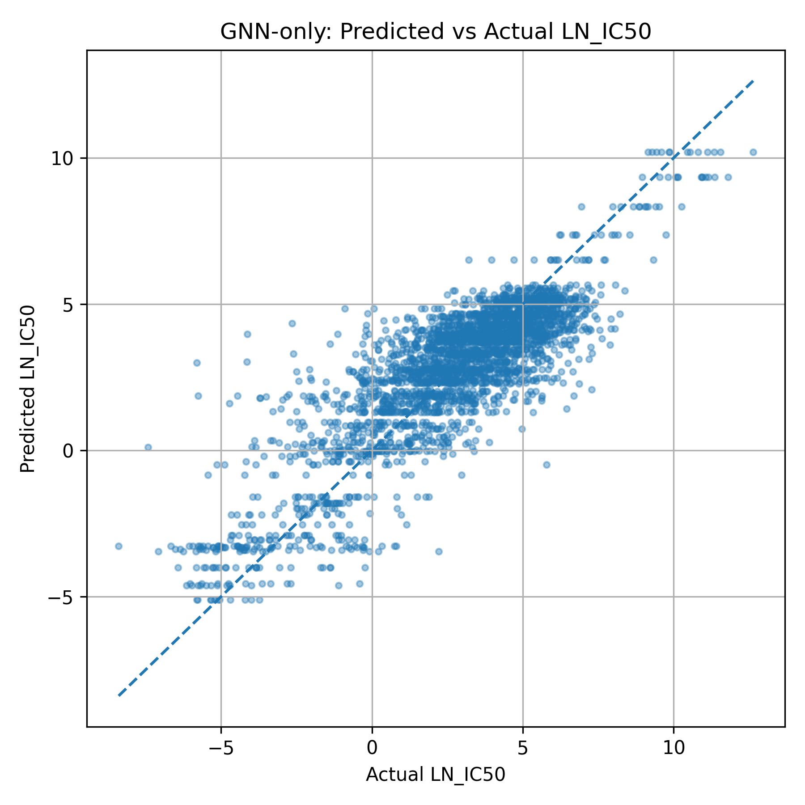
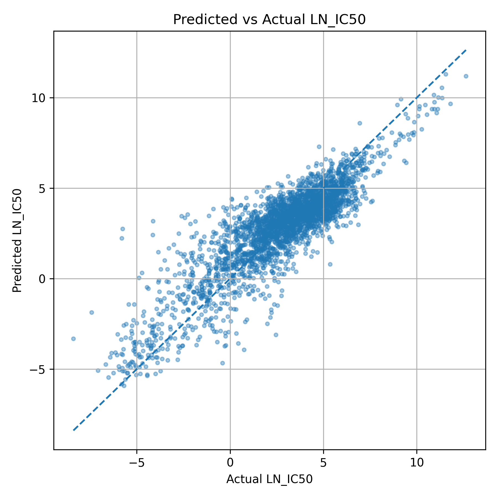
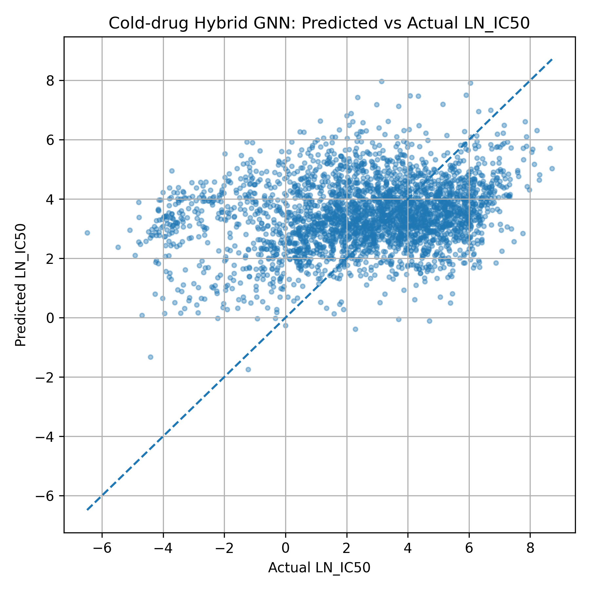

\# GNN-Based Anticancer Drug Response Prediction

A deep learning research project investigating anticancer drug response prediction using Graph Neural Networks (GNNs), molecular graphs, and cancer cell-line information.

The project compares a molecular graph-only model with a hybrid GNN architecture and evaluates how well these approaches generalize to previously unseen drugs.

\## Project Overview

Anticancer drug response prediction aims to estimate how effectively a drug acts against a particular cancer cell line.

This project uses the GDSC2 dataset and represents drugs as molecular graphs generated from SMILES strings.

The prediction target is \*\*LN\_IC50\*\*, a continuous measure of drug sensitivity.

\## Models

\### 1. GNN-Only Baseline

\- Converts SMILES representations into molecular graphs using RDKit.

\- Uses graph convolutional layers to learn molecular representations.

\- Applies global mean pooling and fully connected prediction layers.

\- Predicts LN\_IC50 using drug structure alone.

\### 2. Hybrid GNN

\- Uses the same GNN-based molecular encoder.

\- Adds learned embeddings representing cancer cell-line identities.

\- Combines drug and cell-line embeddings.

\- Predicts drug sensitivity from the combined representation.

\## Experimental Setup

Two evaluation settings were investigated:

\*\*Warm-start evaluation:\*\* Training and test sets may contain the same drugs and cell lines, but not the same drug-cell response records.

\*\*Cold-drug evaluation:\*\* The test set contains drugs that were not present during training, providing a more challenging generalization test.

The warm-start experiment used 30,000 sampled records, divided into 24,000 training, 3,000 validation, and 3,000 test records.

\## Results

| Model | RMSE | MAE | Pearson Correlation |

|---|---:|---:|---:|

| GNN-only (warm-start) | 1.5481 | 1.1755 | 0.8429 |

| Hybrid GNN (warm-start) | 1.3950 | 1.0619 | 0.8758 |

| Hybrid GNN (cold-drug) | 2.7325 | 2.1175 | 0.2431 |

\*\*Key findings:\*\*

\- Including cancer cell-line identity information improved warm-start prediction performance.

\- The hybrid GNN achieved the lowest warm-start RMSE.

\- Performance declined substantially when predicting responses for previously unseen drugs.

\- Generalization to unseen molecular structures remains an important research challenge.

These results come from the project's experimental evaluation and should not be interpreted as predictions of patient treatment outcomes.

\## Research Paper

**Graph Neural Network-Based Anticancer Drug Response Prediction Using Molecular Graphs and Cell-Line Information**

[Read the Full Research Paper (PDF)](docs/GNN_Anticancer_Drug_Response_Report.pdf)

The paper presents the methodology, model architectures, experimental evaluation, and limitations of the study.

\## Experimental Visualizations

\### 1. GNN-Only Model — Predicted vs Actual

\### 2. Warm-Start Predictions

\### 3. Cold-Drug Predictions

The visualizations illustrate the difference between warm-start prediction performance and generalization to previously unseen drugs.

\## Technologies

\- Python 3.9

\- PyTorch

\- PyTorch Geometric

\- RDKit

\- scikit-learn

\- pandas

\- NumPy

\- Matplotlib

\## Project Structure

\- `src/` — Data preprocessing, molecular graph construction, model architectures, training and evaluation scripts

\- `data/` — Local research datasets (excluded from the repository)

\- `results/` — Generated models and experimental outputs (excluded pending review)

\## Dataset

The project uses the \*\*Genomics of Drug Sensitivity in Cancer (GDSC2)\*\* dataset.

The original dataset and processed data files are excluded from this repository. Researchers should obtain the data from the original provider and follow the applicable usage conditions.

\## Reproducibility

The repository includes the source code for the experiments. Reproduction requires the relevant Python dependencies, access to the dataset, and data preprocessing.

A fully automated installation and execution workflow has not yet been documented.

\## Limitations

\- Warm-start results do not demonstrate generalization to entirely new drugs.

\- Cold-drug performance was considerably weaker.

\- Cell lines were represented through learned identity embeddings rather than explicit gene-expression or multi-omics features.

\- The models were evaluated on cancer cell-line drug response data, not clinical patient outcomes.

\## Disclaimer

This is an academic machine-learning research project. The models are not clinically validated and are not intended to guide cancer treatment decisions.

